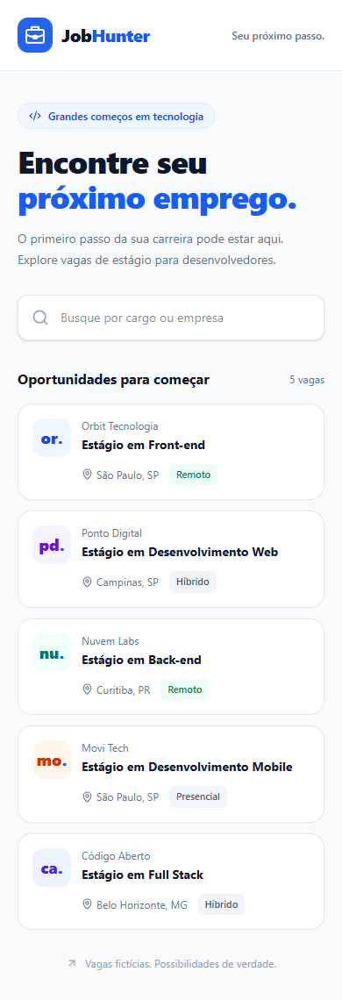
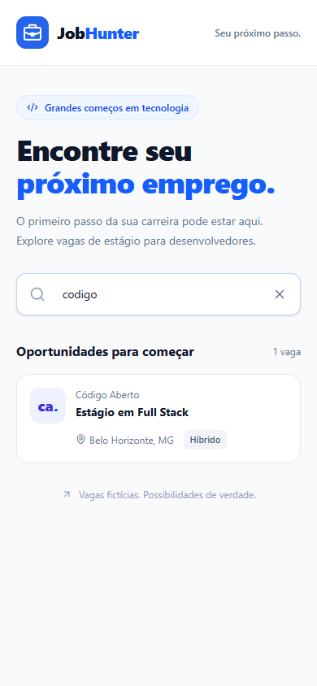
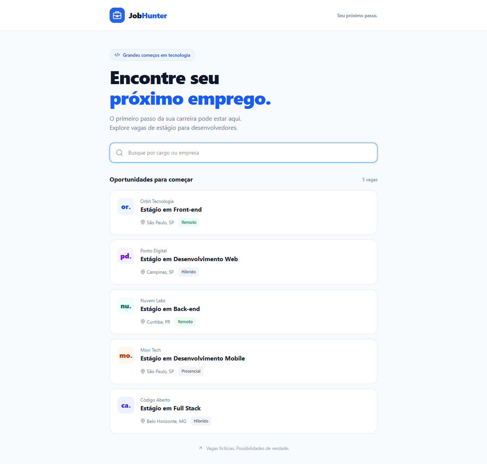

# JobHunter

Mural simples de vagas de estágio para desenvolvedores, com uma única tela e funcionamento offline no Android.

**SENAI · PPDM2 — 4º semestre · Aula 16 — Personalização Nativa · Aluno 25.**

## Funcionalidades

- Cinco vagas fictícias com cargo, empresa, localização e modalidade.
- Busca por cargo ou empresa, ignorando maiúsculas e acentos.
- Contagem de resultados, botão para limpar a busca e mensagem de lista vazia.
- Layout responsivo, ícone e splash nativos personalizados.

Os dados, imagens, estilos e fontes do sistema são locais. O APK não depende de servidor ou conexão. O preview no navegador exige o servidor local; não é uma PWA instalável com cache offline.

## Tecnologias

React 19, TypeScript, Vite 6, Tailwind CSS 4, Lucide React e Capacitor 7 (Android e Splash Screen). Sharp e @capacitor/assets geram as imagens; Playwright valida a interface.

## Identidade visual

O [card do aluno 25 na aula](https://ppdm16.pages.dev/) foi consultado: **JobHunter — Mural de Vagas de Estágio para Desenvolvedores**, cor primária **#2563EB**, símbolo sugerido **fa-briefcase (maleta)**. Complementos: branco e azul-escuro #0F172A.

A maleta foi desenhada em SVG local, sem dependência de imagens externas. O ícone fonte tem fundo opaco, sem cantos arredondados, e o desenho ocupa a região central segura. Na splash, o desenho fica dentro dos 1200 pixels centrais.

| Ícone — 1024 × 1024 | Splash — 2732 × 2732 |
| --- | --- |
|  |  |

Para regenerar os PNGs e as densidades Android:

```sh
npm run assets
npx cap sync android
```

Recursos nativos incluídos em `android/app/src/main/res/`, nas densidades mdpi, hdpi, xhdpi, xxhdpi e xxxhdpi, além de variantes geradas pela ferramenta.

No Android 12+, o sistema controla a splash de lançamento: fundo azul e ícone central, configurados em `styles.xml` com `Theme.SplashScreen`. A imagem quadrada de 2732 pixels não é exibida livremente como uma tela inteira nessa API. As propriedades `androidScaleType` e `backgroundColor` do plugin não substituem esse comportamento do sistema. Referência: [documentação do Splash Screen](https://capacitorjs.com/docs/v7/apis/splash-screen).

## Executar

Pré-requisito: Node.js 22 e npm.

```sh
npm ci
npm run dev
```

Abra o endereço exibido no terminal. Para validar o build:

```sh
npm run build
npm run preview
```

Para testar a busca e capturar novamente os screenshots (requer Microsoft Edge instalado):

```sh
npm run build
npm test
```

## Android

Requisitos: Java **21**, Android SDK **35** e Android Studio. Capacitor configurado com `com.jobhunter.app`, nome `JobHunter` e `webDir: dist`.

```sh
npm run build
npx cap sync android
npx cap open android
```

A pasta `android/` já está criada; não é necessário executar `cap add` novamente. Configure `ANDROID_HOME` para seu SDK ou use `android/local.properties`, sem versionar caminhos pessoais.

Para compilar no PowerShell, usando o Java 21 incluído no Android Studio:

```powershell
$env:JAVA_HOME = 'C:\Program Files\Android\Android Studio\jbr'
cd android
.\gradlew.bat assembleDebug --no-daemon
```

Em Linux/macOS com Java 21:

```sh
cd android
chmod +x gradlew
./gradlew assembleDebug --no-daemon
```

Saída esperada: `android/app/build/outputs/apk/debug/app-debug.apk`. É um APK Debug para testes e instalação manual, não uma versão de publicação na loja.

## Enviar ao GitHub e baixar o APK

O workflow foi adaptado do exemplo da aula, acrescentando `npm ci`, build React, configuração do SDK e falha explícita se o APK não existir. Executa em push para `main` ou `master` e também manualmente.

Revise os arquivos e execute, quando desejar publicar:

```sh
git add .
git commit -m "Cria JobHunter com identidade nativa e build Android"
git push -u origin HEAD
```

Use a branch `main` ou `master` para disparar a automação. Confira a branch atual com `git branch --show-current`.

1. Abra o [repositório](https://github.com/MatheusNunes1B/JobHunter).
2. Entre em **Actions → Construir APK Android (Capacitor)**.
3. Abra uma execução bem-sucedida; para iniciar manualmente, use **Run workflow**.
4. Em **Artifacts**, baixe **meu-aplicativo-apk**.
5. Extraia o ZIP e instale `app-debug.apk` no Android.

Projeto enviado ao GitHub com autorização do aluno. O workflow instala explicitamente os pacotes do SDK Android utilizados pelo projeto.

## Screenshots reais

Capturas da aplicação executando no navegador Edge, em viewport móvel e desktop. Não são fotos de emulador nem mockups da splash nativa.

| Tela inicial (390 px) | Busca por empresa |
| --- | --- |
|  |  |



## Validação

- Build React/TypeScript e sincronização Capacitor executados.
- Teste de interface: cinco vagas, busca por cargo e empresa, acentos, lista vazia, limpeza e interação sem rede após carregamento.
- Layout sem rolagem horizontal em 320, 390 e 1280 pixels.
- PNGs e recursos Android conferidos.
- Dependências de produção: `npm audit --omit=dev` sem vulnerabilidades na validação. Há quatro alertas moderados transitivos nas ferramentas de desenvolvimento (@capacitor/assets); não são incluídas no bundle do aplicativo.

### Resultado da compilação local

APK Debug compilado com sucesso (`BUILD SUCCESSFUL`) usando Java 21, SDK 35 e Gradle 8.11.1. Arquivo: `android/app/build/outputs/apk/debug/app-debug.apk`. A instalação e a aparência da splash em dispositivo/emulador ainda não foram testadas.

Execute `npm run validate` para conferir novamente as dimensões/opacidade dos PNGs, as pastas de densidade e os campos principais do YAML.
